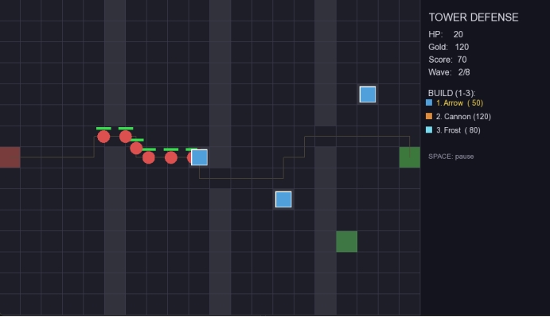
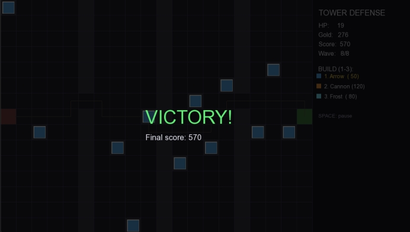

# Tower Defense

[](https://isocpp.org/)
[](https://cmake.org/)
[](https://www.sfml-dev.org/)
[](#tests)

A Tower Defense game in C++17 using SFML 3, with A* pathfinding, JSON configs, and a clean entity-based architecture.

Игра Tower Defense на C++17 с использованием SFML 3: A*-поиск пути, JSON-конфиги и чистая архитектура на сущностях.

---

## 🇬🇧 English

### About
A complete Tower Defense game implementing classic mechanics: enemies follow a path, the player builds towers to stop them, and the game scales over 8 waves. It demonstrates **A\* pathfinding**, an **entity-based architecture** (Enemy / Tower / Projectile), and **JSON-based configuration** for tuning balance without recompilation.

### Screenshots



*In-game: enemies moving along the A\* path, towers firing, UI panel on the right.*



*Victory screen after clearing all 8 waves.*

> If the screenshots don't show up, make sure the `docs/` folder with `screenshot.png` and `victory.png` is committed to the repository.

### Features
- **A\* pathfinding** — enemies walk the shortest path from spawn to base
- **Dynamic path validation** — you can't build a tower if it would block the path
- **3 tower types**: Arrow (fast, single-target), Cannon (AoE), Frost (slows enemies)
- **3 enemy types**: Normal, Fast, Tank — each with distinct HP, speed and reward
- **8 waves** with progressively stronger enemies
- **JSON config** (`assets/config.json`) loaded at startup — change grid size, starting gold, HP without recompiling
- **In-game UI**: HP, gold, score, wave counter, tower prices, pause
- **Victory / Defeat** screens
- **41 unit tests** (Google Test) covering every core module

### Project Structure
```
tower-defense/
├── include/td/         # Public API
│   ├── Vector2.h       # 2D math (float + int variants)
│   ├── Grid.h          # Cell grid (ASCII-art support)
│   ├── Pathfinder.h    # A* implementation
│   ├── Enemy.h         # Enemies with HP, speed, slow effect
│   ├── Tower.h         # 3 tower types with cooldowns
│   ├── Projectile.h    # Flying projectiles with AoE/slow
│   ├── Wave.h          # Wave manager
│   ├── Player.h        # HP, gold, score
│   ├── Config.h        # JSON-based config
│   ├── Renderer.h      # SFML wrapper
│   └── Game.h          # Main game loop
├── src/                # Implementations
├── tests/              # 41 tests (Google Test)
├── third_party/json/   # Custom JSON parser (from another project)
├── assets/config.json  # Game balance
└── docs/               # Screenshots
```

### Controls
| Key | Action |
|---|---|
| **1 / 2 / 3** | Select tower type (Arrow / Cannon / Frost) |
| **Left Mouse** | Build selected tower on hovered cell |
| **Mouse hover** | Show preview / tower range |
| **Space** | Pause / resume |
| **Close window** | Quit |

### Getting Started

#### Prerequisites
- Visual Studio 2022 ("Desktop development with C++")
- CMake 3.20+
- vcpkg

#### Build
1. Install SFML and Google Test via vcpkg:
   ```bash
   vcpkg install sfml:x64-windows
   vcpkg install gtest:x64-windows
   ```
2. Clone:
   ```bash
   git clone https://github.com/Bloodmoon001/tower-defense.git
   cd tower-defense
   ```
3. Open the folder in Visual Studio (`File` → `Open` → `Folder`).
4. Select `x64-Release`, press `F5`.

> **Font note:** the game loads `C:\Windows\Fonts\arial.ttf` for UI text. If it's missing on your system, edit `Renderer::Renderer` in `src/Renderer.cpp` to point to another TTF font.

### Tests
```bash
./bin/Release/td_tests.exe
```
Expected: `[  PASSED  ] 41 tests.`

### License
MIT License. See `LICENSE`.

---

## 🇷🇺 Русский

### О проекте
Полноценная игра Tower Defense с классическими механиками: враги идут по маршруту, игрок ставит башни, чтобы их остановить, сложность растёт на протяжении 8 волн. Проект демонстрирует **A\*-поиск пути**, **архитектуру на сущностях** (Enemy / Tower / Projectile) и **JSON-конфигурацию** для настройки баланса без перекомпиляции.

### Скриншоты


*В игре: враги идут по маршруту A\*, башни стреляют, справа UI-панель.*


*Экран победы после прохождения всех 8 волн.*


### Возможности
- **A\*-поиск пути** — враги идут кратчайшим маршрутом от спавна до базы
- **Проверка пути в реальном времени** — нельзя поставить башню, если она перекроет путь
- **3 типа башен**: Arrow (быстрая, одиночная цель), Cannon (урон по площади), Frost (замедляет врагов)
- **3 типа врагов**: Normal, Fast, Tank — с разными HP, скоростью и наградой
- **8 волн** с постепенным ростом сложности
- **JSON-конфиг** (`assets/config.json`) — размер сетки, стартовое золото, HP без пересборки
- **UI в игре**: HP, золото, счёт, номер волны, цены башен, пауза
- **Экраны Victory / Defeat**
- **41 unit-тест** (Google Test) — покрывают все основные модули

### Структура проекта
```
tower-defense/
├── include/td/         # Публичный API
├── src/                # Реализация
├── tests/              # 41 тест (Google Test)
├── third_party/json/   # Собственный JSON-парсер (из другого проекта)
├── assets/config.json  # Баланс игры
└── docs/               # Скриншоты
```

### Управление
| Клавиша | Действие |
|---|---|
| **1 / 2 / 3** | Выбор типа башни (Arrow / Cannon / Frost) |
| **ЛКМ** | Поставить башню на клетку под курсором |
| **Наведение мыши** | Превью клетки / радиус башни |
| **Space** | Пауза / продолжить |
| **Закрыть окно** | Выход |

### Сборка и запуск

#### Требования
- Visual Studio 2022 («Разработка классических приложений на C++»)
- CMake 3.20+
- vcpkg

#### Сборка
1. Установите зависимости:
   ```bash
   vcpkg install sfml:x64-windows
   vcpkg install gtest:x64-windows
   ```
2. Склонируйте репозиторий:
   ```bash
   git clone https://github.com/Bloodmoon001/tower-defense.git
   cd tower-defense
   ```
3. Откройте папку в Visual Studio (`Файл` → `Открыть` → `Папка`).
4. Выберите `x64-Release`, нажмите `F5`.

> **Про шрифт:** игра загружает `C:\Windows\Fonts\arial.ttf` для текста UI. Если у вас его нет — поправьте `Renderer::Renderer` в `src/Renderer.cpp`, указав другой TTF-шрифт.

### Тесты
```bash
./bin/Release/td_tests.exe
```
Ожидаемый вывод: `[  PASSED  ] 41 tests.`

### Лицензия
MIT License. См. файл `LICENSE`.

---